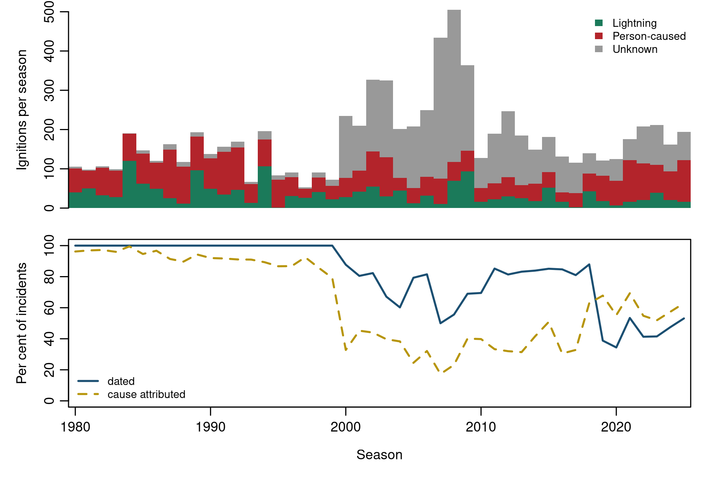
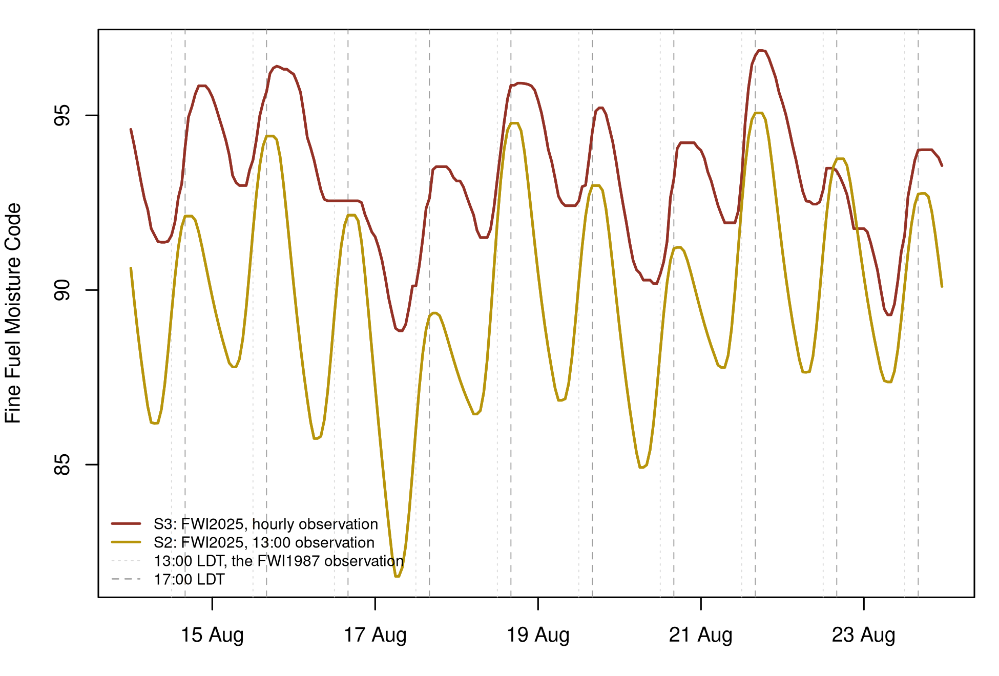
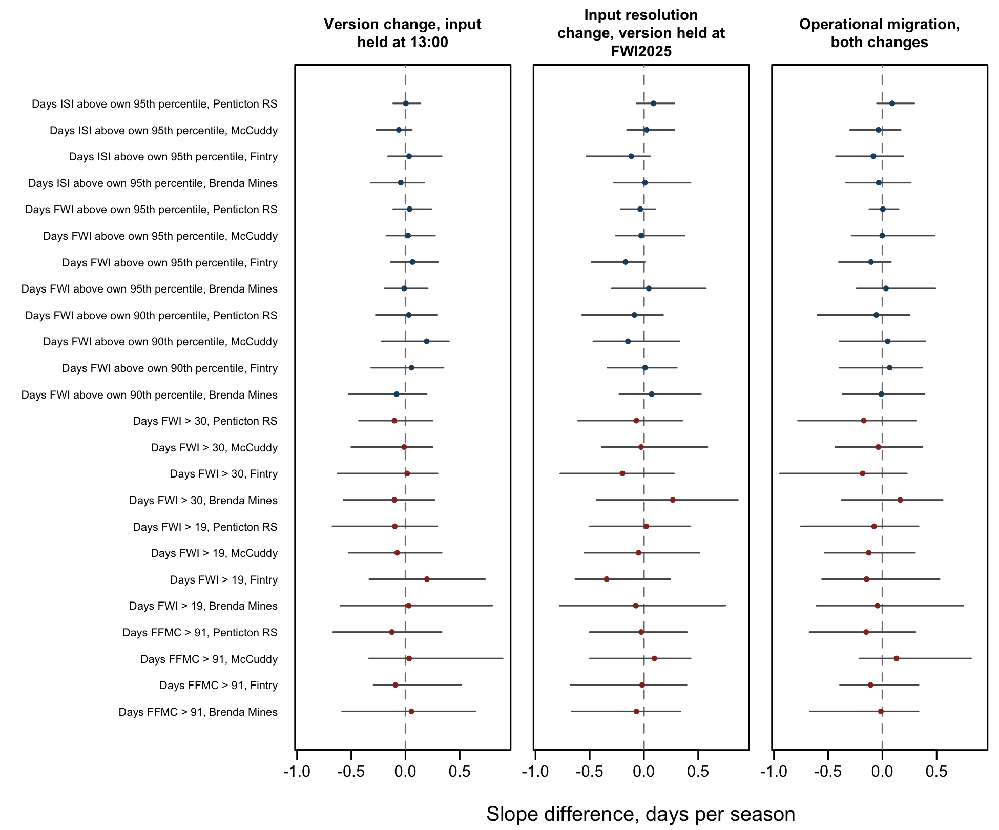

# Evaluating the 2025 revision of the Canadian Forest Fire Weather Index System against 31 seasons of fire danger trends and ignitions in the Okanagan basin

Seamus Murphy, ORCID 0000-0002-1792-0351.

Everything below is generated from the render of `01.manuscript/manuscript.qmd` by `05.scripts/build_readme.R`, which quotes the manuscript's own output files and computes nothing of its own.

## Abstract

The 2025 revision of the Canadian Forest Fire Weather Index System recalculated its three fuel moisture codes hourly, with faster litter drying and per-event rain thresholds. The revision also limited the Initial Spread Index wind effect above 40 kilometres per hour. The weather input changed from daily to hourly. No study had separated the two changes or tested trends across both. This study computed three series from one hourly record of 104 station-seasons at five Okanagan basin stations, British Columbia, 1991 to 2025. The 1984 version used the 13:00 observation, the 2025 version that observation and, separately, hourly weather, and twelve metrics covered every component. Trends were estimated by Theil-Sen slope and Mann-Kendall test with the Hamed and Rao autocorrelation correction, slope differences by moving-block bootstrap, and daily ignitions by negative binomial regression. Of 144 trends at four stations, 140 were positive and 35 passed false discovery rate correction, 33 at one station. Between versions, levels moved and no trend difference was detected. At fixed input, the version change raised the mean Duff Moisture Code by 5.8 and the peak Drought Code by 60, towards drier fuel. Across both changes, 62 rather than 57 days per season exceeded a Fine Fuel Moisture Code of 91. No slope difference between series excluded zero, with median interval half widths of 10.1 to 16.8 days. Lightning ignition skill differed by 0.0005 log likelihood units per day. Trends should be reported as days above a percentile threshold, with the version stated. 

## Figures

**Figure 1.** Study area, ignition record and weather record. Okanagan River watershed group, British Columbia Freshwater Atlas (GeoBC Branch, 2026d), 795,417 ha. Points were the 8,176 wildfire incidents recorded inside the basin between 1980 and 2025 in the BC Wildfire Service historical incident record (BC Wildfire Service, 2026c), coloured by reported cause. Incidents before 1991 preceded the study period. Of all incidents, 3,633 had no recorded cause and were drawn as unknown. Triangles were the 5 BC Wildfire Service fire weather stations inside the basin (BC Wildfire Service, 2026a), the entire weather record used. Lakes, streams and municipalities came from the Freshwater Atlas and the provincial administrative boundaries (GeoBC Branch, 2026b, 2026c; Governance and Structure Branch, 2026). Relief was a hillshade of a 99 m digital elevation model (Amazon Web Services, 2026). Coordinate reference system NAD83 / BC Albers, EPSG:3005; graticule labelled in WGS84 degrees. Representative fraction approximately 1:861,000 at a 132 mm panel width. Map lines delineate study areas and do not necessarily depict accepted national boundaries.

**Figure 2.** Ignitions by season and the completeness of their records. Upper panel, incidents per season by reported cause, 8,176 in all. Lower panel, the share of incidents with an ignition date and the share with a recorded cause. The two shares were 100 and 92 per cent before 2000 and 67 and 40 per cent from 2000 onward.

**Figure 3.** Ten days of the hourly Fine Fuel Moisture Code at Penticton RS in August 2003, under FWI2025. One line was driven by the observed hourly weather and the other by the 13:00 observation alone. Both lines were FWI2025 on the same days, and they differed only in the weather input. The vertical lines marked 13:00 and 17:00 local daylight time (LDT). FWI1987 took its observation at 13:00 LDT, and 17:00 LDT was 16:00 local standard time, the hour of the daily value.

**Figure 4.** Seasonal metrics by season under the three series, pooled across stations as the station mean. The set of stations reporting changed between seasons, so the points did not follow a fixed set of stations. Each line was drawn through the median point of the station means, with the slope the trend table reported, the median of the per-station Theil-Sen slopes for that series. The second question concerned the extreme-day counts, under the prediction that the absolute counts separated between series and the relative counts did not. FWI was the Fire Weather Index, BUI the Buildup Index and ISI the Initial Spread Index. DMC was the Duff Moisture Code, DC the Drought Code and FFMC the Fine Fuel Moisture Code.

**Figure 5.** Difference in Theil-Sen slope between series for the six extreme-day counts, which were all measured in days per season and shared one axis. Points were station estimates, and bars were paired moving-block bootstrap 95 per cent intervals over 4,000 resamples of blocks of consecutive seasons. Red marked the three absolute thresholds and blue the three thresholds internal to each series. The prediction under test was that the red points separated from zero and the blue ones did not. FFMC was the Fine Fuel Moisture Code, FWI the Fire Weather Index and ISI the Initial Spread Index.

## Tables

**Table 1.** Expected direction of each metric family and the literature it rested on.

| Metric family | Expected direction | Basis |
| :--- | :--- | :--- |
| Mean Fire Weather Index and seasonal severity rating, the Daily Severity Rating summed over the season | Positive trend in all three series; small difference in level between versions | Moisture deficit rising since breakpoints in 1999 in summer and 2011 in spring (Parisien et al., 2023, p. 3); rising May to October mean Fire Weather Index over western North America 1951 to 2021 in ERA5, the fifth reanalysis of the European Centre for Medium-Range Weather Forecasts, with “ERA5 FWI values decreasing into the 1980s before increasing into the current decade, making a linear trend analysis sensitive to endpoint selection” (Queen et al., 2025, p. 2); comparability of levels claimed in section 4.1 of Canadian Forest Service Fire Danger Group (2025) |
| Days above absolute thresholds, FFMC 91, FWI 19 and FWI 30 | Positive trend; steeper under FWI2025 than FWI1987; input resolution also moves the count | Faster litter drying than the 1977 hourly Fine Fuel Moisture Code (Canadian Forest Service Fire Danger Group, 2025, p. 18), and this study’s conjecture that FWI2025 also dried faster than the daily FWI1987 code; mostly positive trends where largest and significant in “potential fire spread days”, days with FWI above 19, over Canada 1979 to 2002 and the contiguous United States 1979 to 2015 (Jain et al., 2017, pp. 1009, 1011, 1013); extreme days sensitive to how the input weather is summarised (Herrera et al., 2013; Rodell et al., 2024), and the difference in their count between daily aggregates and noon weather had a trend of 0.22 to 0.39 days per decade (Matteo et al., 2025) |
| Days above each series’ own 90th and 95th percentiles | Positive trend; little difference between series; bias outside the base period | Percentile thresholds “sample the same part of the probability distribution” at each location, here in each series (Zhang et al., 2011, p. 855); days above the 95th percentile of an index rose with “increasing trends and change points for many parts of the world, including western North America” under a block bootstrap Mann-Kendall test (Richardson et al., 2022, p. 4); base-period inhomogeneity (Dunn and Morice, 2022; Zhang et al., 2005) |
| Mean Initial Spread Index and days above its own 95th percentile | Positive trend; little difference between series, because the new wind function acts only above 40 km h-1 | The fire weather day of Richardson et al. (2022), a day when a fire danger index exceeded its climatological 95th percentile; the wind function change “primarily relevant for extreme fire conditions” (Canadian Forest Service Fire Danger Group, 2025, p. 21) |
| Mean Duff Moisture Code and peak Drought Code | Positive trend; higher level under FWI2025 than FWI1987 at fixed input, and a different level under hourly input; trend unchanged | Per degree of warming, precipitation had to rise about 10 per cent for the Duff Moisture Code and 5 per cent for the Drought Code to hold the mean code unchanged (Flannigan et al., 2016, p. 59); over 1901 to 2002 western Canada “recorded a trend toward decreasing dryness” in the Monthly Drought Code, a form of the Drought Code computed from monthly weather (Girardin and Wotton, 2009); at fixed input, drying over each hour between sunrise and sunset in place of the monthly day length factors of FWI1987 (Canadian Forest Service Fire Danger Group, 2025, p. 20; Van Wagner, 1987a, pp. 12, 14); under hourly input, cumulative rain thresholds “will err to the dry side of fuel moisture” on “days where two rainfall events are spaced apart by more than six hours” (Canadian Forest Service Fire Danger Group, 2025, p. 21); the startup value moved the early season Drought Code (McElhinny et al., 2020) |
| Daily lightning, person-caused and all-cause ignitions | Positive association with daily danger; weaker for lightning without strike data | Daily fire occurrence in British Columbia (Magnussen and Taylor, 2012); strike data in lightning occurrence models (Wotton and Martell, 2005, pp. 1392, 1396); percentile analysis and logistic regression of fire days on an index (Andrews et al., 2003) |

**Table 2.** The weather record. Season counts ran from 1988 to 2025. A season was kept when coverage reached 95 per cent and no single gap exceeded 24 hours, and was otherwise dropped. A station was not reporting in a season with no record. Coverage was the share of the 1 April to 30 September hours in which temperature, humidity and wind were all observed, before any gap filling.

| Station | Station number | Elevation (m) | Installed | First season kept | Last season kept | Seasons kept | Seasons dropped | Not reporting | Median coverage (%) |
| :--- | :--- | :--- | :--- | :--- | :--- | :--- | :--- | :--- | :--- |
| Penticton RS | 328 | 492 | 1988 | 1991 | 2025 | 27 | 11 | 0 | 100.0 |
| McCuddy | 334 | 1,023 | 1989 | 1994 | 2025 | 26 | 11 | 1 | 100.0 |
| Fintry | 298 | 526 | 1990 | 1996 | 2025 | 25 | 7 | 6 | 100.0 |
| Brenda Mines | 283 | 1,463 | 1989 | 1998 | 2025 | 20 | 17 | 1 | 99.9 |
| West Kelowna | 1277 | 650 | 2016 | 2017 | 2024 | 6 | 3 | 29 | 99.8 |

**Table 3.** Where each absolute threshold fell in each series’ own 1991 to 2020 reference distribution, averaged over stations. A threshold at the same percentile in every series would have meant the three series were interchangeable for counting extremes. The reference median was the median of that component over the same distribution. Days per season above were the mean over every kept station-season from 1991 to 2025.

| Series | Component | Threshold | Percentile of threshold | Days per season above | Reference median |
| :--- | :--- | :--- | :--- | :--- | :--- |
| S1: FWI1987, 13:00 observation | FFMC | 91 | 65.1 | 57.2 | 89.3 |
| S2: FWI2025, 13:00 observation | FFMC | 91 | 66.2 | 55.4 | 89.5 |
| S3: FWI2025, hourly observation | FFMC | 91 | 62.5 | 61.9 | 89.8 |
| S1: FWI1987, 13:00 observation | FWI | 19 | 52.5 | 78.1 | 19.3 |
| S2: FWI2025, 13:00 observation | FWI | 19 | 47.6 | 85.4 | 21.4 |
| S3: FWI2025, hourly observation | FWI | 19 | 52.6 | 77.8 | 19.5 |
| S1: FWI1987, 13:00 observation | FWI | 30 | 74.8 | 43.0 | 19.3 |
| S2: FWI2025, 13:00 observation | FWI | 30 | 72.4 | 46.7 | 21.4 |
| S3: FWI2025, hourly observation | FWI | 30 | 75.2 | 42.9 | 19.5 |

**Table 4.** Theil-Sen slopes per season for each seasonal metric under each series, pooled across stations as the median station slope, with the range across stations. Significance was tested by Mann-Kendall with the Hamed and Rao variance correction. The count was of stations at which the false discovery rate adjusted p value fell below 0.05 within that station’s twelve-metric family. The minimum detectable trend was the slope this record could resolve at 90 per cent power.

| Series | Metric | Stations | Median slope | Slope range | Stations q < 0.05 | Min detectable |
| :--- | :--- | :--- | :--- | :--- | :--- | :--- |
| S1: FWI1987, 13:00 observation | Mean FWI | 4 | 0.176 | 0.07 to 0.37 | 1 | 0.308 |
| S2: FWI2025, 13:00 observation | Mean FWI | 4 | 0.166 | 0.09 to 0.36 | 1 | 0.311 |
| S3: FWI2025, hourly observation | Mean FWI | 4 | 0.181 | 0.04 to 0.38 | 1 | 0.319 |
| S1: FWI1987, 13:00 observation | Seasonal severity rating | 4 | 13.376 | 7.29 to 28.06 | 1 | 25.835 |
| S2: FWI2025, 13:00 observation | Seasonal severity rating | 4 | 13.884 | 5.24 to 29.93 | 1 | 26.960 |
| S3: FWI2025, hourly observation | Seasonal severity rating | 4 | 14.817 | 7.17 to 29.85 | 1 | 26.996 |
| S1: FWI1987, 13:00 observation | Peak BUI | 4 | 1.606 | 0.78 to 2.76 | 0 | 5.400 |
| S2: FWI2025, 13:00 observation | Peak BUI | 4 | 1.671 | 0.91 to 3.05 | 0 | 6.215 |
| S3: FWI2025, hourly observation | Peak BUI | 4 | 1.918 | 1.32 to 3.20 | 0 | 7.008 |
| S1: FWI1987, 13:00 observation | Mean ISI | 4 | 0.038 | 0.00 to 0.09 | 1 | 0.086 |
| S2: FWI2025, 13:00 observation | Mean ISI | 4 | 0.034 | 0.00 to 0.10 | 1 | 0.096 |
| S3: FWI2025, hourly observation | Mean ISI | 4 | 0.044 | 0.01 to 0.09 | 1 | 0.090 |
| S1: FWI1987, 13:00 observation | Mean DMC | 4 | 0.881 | 0.48 to 1.30 | 1 | 2.202 |
| S2: FWI2025, 13:00 observation | Mean DMC | 4 | 0.917 | 0.57 to 1.34 | 1 | 2.399 |
| S3: FWI2025, hourly observation | Mean DMC | 4 | 0.778 | 0.60 to 1.66 | 1 | 2.601 |
| S1: FWI1987, 13:00 observation | Peak DC | 4 | 3.593 | 3.15 to 7.84 | 1 | 10.121 |
| S2: FWI2025, 13:00 observation | Peak DC | 4 | 3.756 | 2.95 to 9.01 | 1 | 10.862 |
| S3: FWI2025, hourly observation | Peak DC | 4 | 3.894 | 3.44 to 9.08 | 1 | 10.744 |
| S1: FWI1987, 13:00 observation | Days FFMC > 91 | 4 | 0.761 | 0.28 to 1.33 | 1 | 1.135 |
| S2: FWI2025, 13:00 observation | Days FFMC > 91 | 4 | 0.715 | 0.33 to 1.23 | 1 | 1.045 |
| S3: FWI2025, hourly observation | Days FFMC > 91 | 4 | 0.751 | 0.26 to 1.22 | 1 | 1.040 |
| S1: FWI1987, 13:00 observation | Days FWI > 19 | 4 | 0.798 | 0.45 to 1.50 | 1 | 1.594 |
| S2: FWI2025, 13:00 observation | Days FWI > 19 | 4 | 0.710 | 0.48 to 1.70 | 1 | 1.580 |
| S3: FWI2025, hourly observation | Days FWI > 19 | 4 | 0.696 | 0.40 to 1.35 | 1 | 1.509 |
| S1: FWI1987, 13:00 observation | Days FWI > 30 | 4 | 0.711 | 0.20 to 1.43 | 1 | 1.327 |
| S2: FWI2025, 13:00 observation | Days FWI > 30 | 4 | 0.654 | 0.10 to 1.44 | 1 | 1.317 |
| S3: FWI2025, hourly observation | Days FWI > 30 | 4 | 0.606 | 0.36 to 1.25 | 1 | 1.295 |
| S1: FWI1987, 13:00 observation | Days FWI above own 90th percentile | 4 | 0.337 | 0.17 to 0.72 | 2 | 0.991 |
| S2: FWI2025, 13:00 observation | Days FWI above own 90th percentile | 4 | 0.450 | 0.09 to 0.78 | 1 | 0.857 |
| S3: FWI2025, hourly observation | Days FWI above own 90th percentile | 4 | 0.333 | 0.16 to 0.79 | 2 | 0.863 |
| S1: FWI1987, 13:00 observation | Days FWI above own 95th percentile | 4 | 0.141 | 0.12 to 0.37 | 1 | 0.700 |
| S2: FWI2025, 13:00 observation | Days FWI above own 95th percentile | 4 | 0.172 | 0.11 to 0.43 | 1 | 0.571 |
| S3: FWI2025, hourly observation | Days FWI above own 95th percentile | 4 | 0.148 | 0.14 to 0.26 | 1 | 0.594 |
| S1: FWI1987, 13:00 observation | Days ISI above own 95th percentile | 4 | 0.087 | -0.04 to 0.32 | 1 | 0.472 |
| S2: FWI2025, 13:00 observation | Days ISI above own 95th percentile | 4 | 0.058 | -0.08 to 0.36 | 1 | 0.454 |
| S3: FWI2025, hourly observation | Days ISI above own 95th percentile | 4 | 0.114 | -0.07 to 0.24 | 1 | 0.380 |

**Table 5.** Difference in Theil-Sen slope between series, by metric and contrast, pooled across stations as the median. Intervals were paired moving-block bootstrap percentile intervals over 4,000 resamples of blocks of consecutive seasons. The resampling preserved both the dependence between series that shared a weather record and the serial correlation within each. Stations excluding zero counted the stations whose own interval did not contain zero. The last column applied the Benjamini and Hochberg correction within each station’s twelve-metric family for that contrast.

| Contrast | Scheme | Metric | Stations | Median difference | Stations excluding zero | Stations q < 0.05 |
| :--- | :--- | :--- | :--- | :--- | :--- | :--- |
| Version change, input held at 13:00 | level | Mean FWI | 4 | -0.005 | 0 | 0 |
| Version change, input held at 13:00 | level | Seasonal severity rating | 4 | -0.085 | 0 | 0 |
| Version change, input held at 13:00 | level | Peak BUI | 4 | 0.146 | 0 | 0 |
| Version change, input held at 13:00 | level | Mean ISI | 4 | -0.001 | 0 | 0 |
| Version change, input held at 13:00 | level | Mean DMC | 4 | 0.042 | 0 | 0 |
| Version change, input held at 13:00 | level | Peak DC | 4 | 0.455 | 0 | 0 |
| Version change, input held at 13:00 | absolute | Days FFMC > 91 | 4 | -0.029 | 0 | 0 |
| Version change, input held at 13:00 | absolute | Days FWI > 19 | 4 | -0.023 | 0 | 0 |
| Version change, input held at 13:00 | absolute | Days FWI > 30 | 4 | -0.057 | 0 | 0 |
| Version change, input held at 13:00 | relative | Days FWI above own 90th percentile | 4 | 0.044 | 0 | 0 |
| Version change, input held at 13:00 | relative | Days FWI above own 95th percentile | 4 | 0.031 | 0 | 0 |
| Version change, input held at 13:00 | relative | Days ISI above own 95th percentile | 4 | -0.020 | 0 | 0 |
| Input resolution change, version held at FWI2025 | level | Mean FWI | 4 | 0.011 | 0 | 0 |
| Input resolution change, version held at FWI2025 | level | Seasonal severity rating | 4 | 0.923 | 0 | 0 |
| Input resolution change, version held at FWI2025 | level | Peak BUI | 4 | 0.247 | 0 | 0 |
| Input resolution change, version held at FWI2025 | level | Mean ISI | 4 | 0.010 | 0 | 0 |
| Input resolution change, version held at FWI2025 | level | Mean DMC | 4 | -0.022 | 0 | 0 |
| Input resolution change, version held at FWI2025 | level | Peak DC | 4 | 0.271 | 0 | 0 |
| Input resolution change, version held at FWI2025 | absolute | Days FFMC > 91 | 4 | -0.021 | 0 | 0 |
| Input resolution change, version held at FWI2025 | absolute | Days FWI > 19 | 4 | -0.062 | 0 | 0 |
| Input resolution change, version held at FWI2025 | absolute | Days FWI > 30 | 4 | -0.048 | 0 | 0 |
| Input resolution change, version held at FWI2025 | relative | Days FWI above own 90th percentile | 4 | -0.038 | 0 | 0 |
| Input resolution change, version held at FWI2025 | relative | Days FWI above own 95th percentile | 4 | -0.030 | 0 | 0 |
| Input resolution change, version held at FWI2025 | relative | Days ISI above own 95th percentile | 4 | 0.017 | 0 | 0 |
| Operational migration, both changes | level | Mean FWI | 4 | 0.005 | 0 | 0 |
| Operational migration, both changes | level | Seasonal severity rating | 4 | 1.006 | 0 | 0 |
| Operational migration, both changes | level | Peak BUI | 4 | 0.373 | 0 | 0 |
| Operational migration, both changes | level | Mean ISI | 4 | 0.006 | 0 | 0 |
| Operational migration, both changes | level | Mean DMC | 4 | 0.036 | 0 | 0 |
| Operational migration, both changes | level | Peak DC | 4 | 0.593 | 0 | 0 |
| Operational migration, both changes | absolute | Days FFMC > 91 | 4 | -0.061 | 0 | 0 |
| Operational migration, both changes | absolute | Days FWI > 19 | 4 | -0.101 | 0 | 0 |
| Operational migration, both changes | absolute | Days FWI > 30 | 4 | -0.105 | 0 | 0 |
| Operational migration, both changes | relative | Days FWI above own 90th percentile | 4 | 0.019 | 0 | 0 |
| Operational migration, both changes | relative | Days FWI above own 95th percentile | 4 | 0.001 | 0 | 0 |
| Operational migration, both changes | relative | Days ISI above own 95th percentile | 4 | -0.035 | 0 | 0 |

**Table 6.** Negative binomial models of daily ignition counts on daily basin Fire Weather Index (FWI), over the 1 May to 30 September window. Each model also included season as a fixed effect, two annual harmonics in day of year and the number of contributing stations. The coefficient was the log change in expected count per unit of Fire Weather Index, identified from within-season variation only. Held-out log likelihood was the mean per day under leave-one-season-out refitting. A larger value was better, and the comparison between series, not the absolute value, was the quantity of interest. The held-out log likelihood was computed for the lightning and all-cause responses with no size limit.

| Response | Series | Coefficient | 95% Wald interval | Rate ratio per 10 FWI | Held-out log likelihood |
| :--- | :--- | :--- | :--- | :--- | :--- |
| Lightning, no size limit | S1: FWI1987, 13:00 observation | 0.0161 | 0.0052 to 0.0269 | 1.17 | -0.4201 |
| Lightning, no size limit | S2: FWI2025, 13:00 observation | 0.0110 | -0.0005 to 0.0225 | 1.12 | -0.4206 |
| Lightning, no size limit | S3: FWI2025, hourly observation | 0.0099 | -0.0003 to 0.0200 | 1.10 | -0.4206 |
| Person-caused, no size limit | S1: FWI1987, 13:00 observation | 0.0480 | 0.0421 to 0.0539 | 1.62 |  |
| Person-caused, no size limit | S2: FWI2025, 13:00 observation | 0.0489 | 0.0428 to 0.0550 | 1.63 |  |
| Person-caused, no size limit | S3: FWI2025, hourly observation | 0.0412 | 0.0360 to 0.0465 | 1.51 |  |
| All causes, no size limit | S1: FWI1987, 13:00 observation | 0.0332 | 0.0289 to 0.0375 | 1.39 | -1.1637 |
| All causes, no size limit | S2: FWI2025, 13:00 observation | 0.0329 | 0.0283 to 0.0374 | 1.39 | -1.1664 |
| All causes, no size limit | S3: FWI2025, hourly observation | 0.0287 | 0.0247 to 0.0327 | 1.33 | -1.1672 |
| All causes, at least 1 ha | S1: FWI1987, 13:00 observation | 0.0706 | 0.0585 to 0.0827 | 2.03 |  |
| All causes, at least 1 ha | S2: FWI2025, 13:00 observation | 0.0702 | 0.0582 to 0.0823 | 2.02 |  |
| All causes, at least 1 ha | S3: FWI2025, hourly observation | 0.0670 | 0.0568 to 0.0772 | 1.95 |  |
| All causes, at least 4 ha | S1: FWI1987, 13:00 observation | 0.0846 | 0.0673 to 0.1018 | 2.33 |  |
| All causes, at least 4 ha | S2: FWI2025, 13:00 observation | 0.0826 | 0.0660 to 0.0992 | 2.28 |  |
| All causes, at least 4 ha | S3: FWI2025, hourly observation | 0.0845 | 0.0706 to 0.0984 | 2.33 |  |

**Table 7.** What a window of this length could and could not resolve. The minimum detectable trend was the slope at which a two-sided test at alpha 0.05 reached 90 per cent power. The power was computed from the residual spread of that metric about its own Theil-Sen line. The slope was adjusted for the efficiency of the Theil-Sen estimator relative to least squares and inflated for lag-one autocorrelation of the residuals. A metric whose observed change was smaller than its minimum detectable change was not evidence of no trend. Such a metric was evidence that this record could not detect a trend of that size.

| Metric | Median observed slope | Minimum detectable trend | Minimum detectable change over the window | Observed change over the window |
| :--- | :--- | :--- | :--- | :--- |
| Mean FWI | 0.180 | 0.308 | 10.46 | 6.14 |
| Seasonal severity rating | 13.486 | 26.895 | 914.43 | 458.54 |
| Peak BUI | 1.740 | 6.024 | 204.81 | 59.17 |
| Mean ISI | 0.040 | 0.089 | 3.04 | 1.37 |
| Mean DMC | 0.883 | 2.363 | 80.34 | 30.02 |
| Peak DC | 3.639 | 10.650 | 362.11 | 123.72 |
| Days FFMC > 91 | 0.751 | 1.081 | 36.76 | 25.54 |
| Days FWI > 19 | 0.739 | 1.551 | 52.74 | 25.11 |
| Days FWI > 30 | 0.625 | 1.295 | 44.04 | 21.25 |
| Days FWI above own 90th percentile | 0.372 | 0.900 | 30.60 | 12.66 |
| Days FWI above own 95th percentile | 0.149 | 0.598 | 20.33 | 5.07 |
| Days ISI above own 95th percentile | 0.070 | 0.443 | 15.06 | 2.39 |

