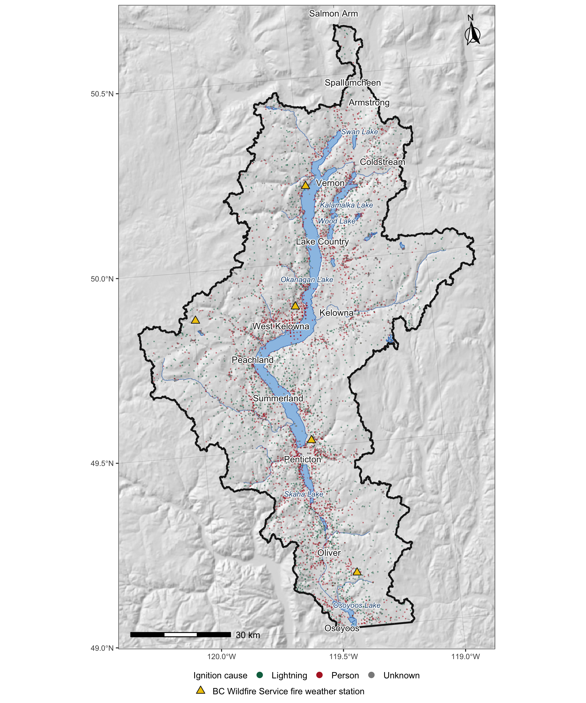
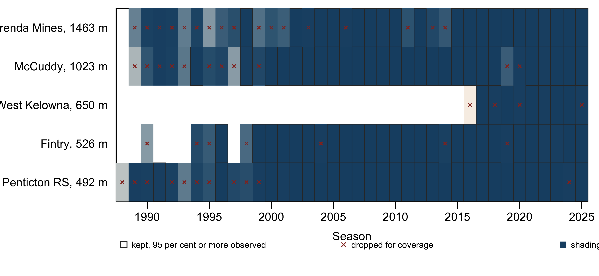
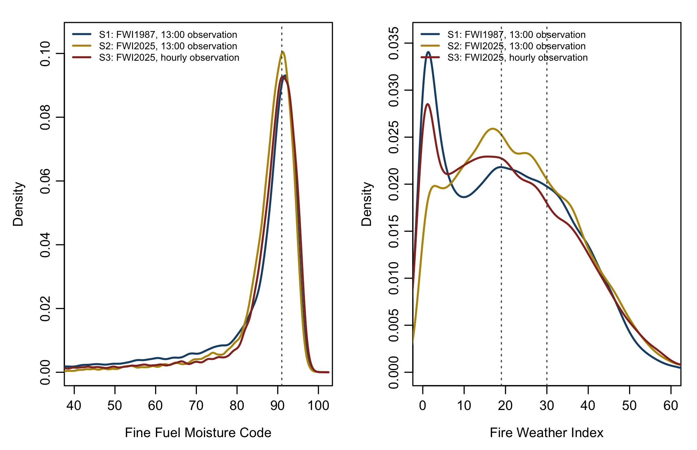
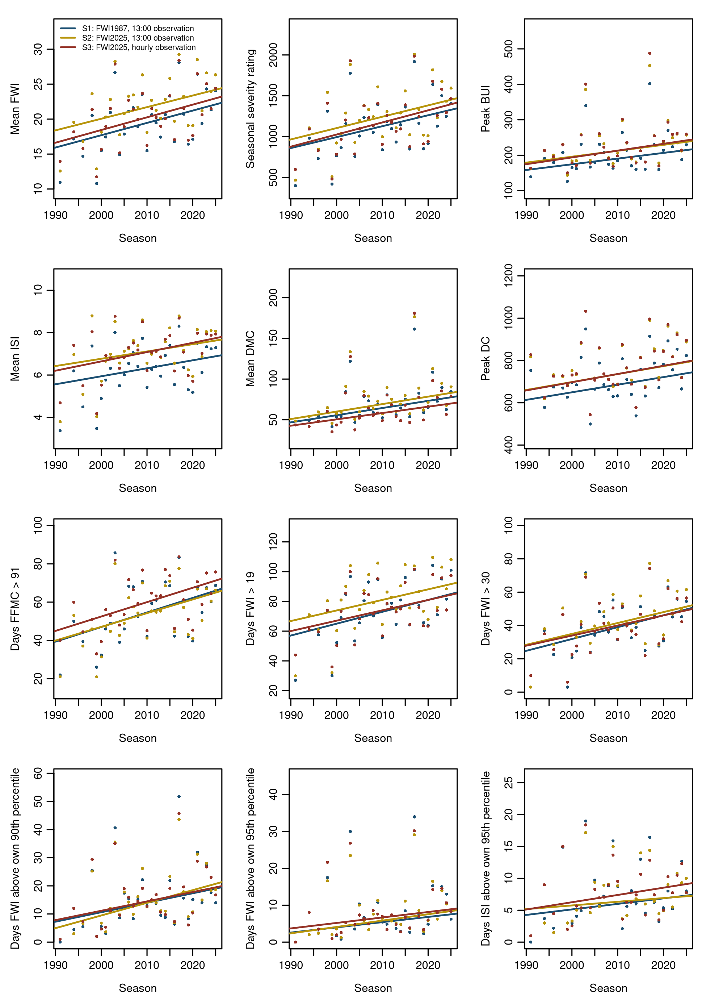
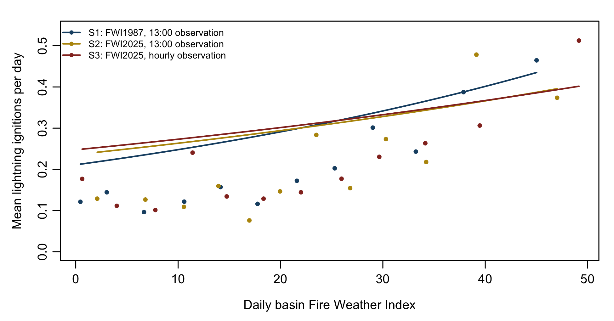
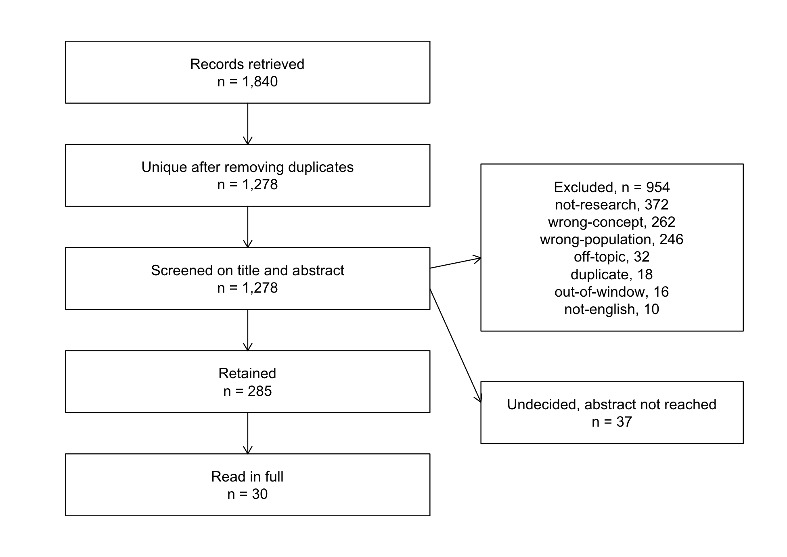

# Fuel moisture code, spread index and hourly weather revisions in the 2025 Canadian Forest Fire Weather Index System tested against 31 seasons of fire danger trends in the Okanagan basin

Seamus Murphy, ORCID 0000-0002-1792-0351.

Everything below is generated from the render of `01.manuscript/manuscript.qmd` by `05.scripts/build_readme.R`, which quotes the manuscript's own output files and computes nothing of its own.

## Abstract

The 2025 revision of the Canadian Forest Fire Weather Index System, within the Canadian Forest Fire Danger Rating System, recalculated its three fuel moisture codes hourly with faster litter drying and per-event rain thresholds, capped the Initial Spread Index wind effect above 40 kilometres per hour, and changed its weather input from one daily observation to hourly. No study had separated the two changes or tested trends across both. This study computed three series from one hourly record at five Okanagan basin stations, British Columbia (104 station-seasons, 31 seasons, 1991 to 2025), the 1987 version on the 13:00 observation and the 2025 version on that observation and on hourly weather, and twelve metrics over every component. Trends were estimated by Theil-Sen slope and Mann-Kendall test with the Hamed and Rao autocorrelation correction, slope differences by moving-block bootstrap, and lightning ignitions by negative binomial regression. Levels moved and trends did not, in that at fixed input the 2025 equations raised the mean Duff Moisture Code by 5.8 units and the peak Drought Code by 60, the dry side the report predicted. Across both changes a Fine Fuel Moisture Code of 91 fell from percentile 65.1 to 62.5 and selected 62 rather than 57 days per season. None of 12 slope differences under fixed thresholds or 12 under percentile thresholds excluded zero, down to 16.8 days over the record, and lightning ignition skill differed by 0.0005. Trends should be reported as days above a percentile threshold, with the version stated. 

## Figures

**Figure 1.** Study area, ignition record and weather record. Okanagan River watershed group, British Columbia Freshwater Atlas (GeoBC Branch, 2026a), 795,417 ha. Points are the 8,176 wildfire incidents recorded inside the basin between 1980 and 2025 in the BC Wildfire Service historical incident record (BC Wildfire Service, 2026a), coloured by reported cause; 3,633 carry no recorded cause and are drawn as unknown. Triangles are the 5 BC Wildfire Service fire weather stations inside the basin (BC Wildfire Service, 2026b), which are the entire weather record used here. Lakes, streams and municipalities are from the Freshwater Atlas and the provincial administrative boundaries (GeoBC Branch, 2026c, 2026d; Governance and Structure Branch, 2026). Relief is a hillshade of a 99 m digital elevation model (Amazon Web Services, 2026). Coordinate reference system NAD83 / BC Albers, EPSG:3005; graticule labelled in WGS84 degrees. Representative fraction approximately 1:861,000 at a 5.2 inch panel width. Map lines delineate study areas and do not necessarily depict accepted national boundaries.

**Figure 2.** Station reporting by season. Each cell is one station-season, shaded by the share of the 1 April to 30 September hours in which temperature, humidity and wind were all observed; an outlined cell met the 95 per cent rule and was kept, a crossed cell was dropped for coverage, and a blank cell is a season in which the station did not report. 104 station-seasons at 5 stations were kept and 49 dropped, over 1991 to 2025.

**Figure 3.** Ignitions by season and the completeness of their records. Upper panel, incidents per season by reported cause, 8,176 in all. Lower panel, the share of incidents carrying an ignition date and the share carrying a recorded cause, which were 100 and 92 per cent before 2000 and 67 and 40 per cent from 2000 onward. Both panels are the same records, so the fall in the lower panel is what makes the cause split in the upper panel unreadable as an ignition trend after 2000.

**Figure 4.** Distribution of the daily Fine Fuel Moisture Code and the daily Fire Weather Index over all kept station-days under the three series, with the absolute thresholds marked. The comparability claim of the 2025 report concerns the position of a value on the scale; an extreme-day count concerns the mass beyond a threshold, which is a different quantity.

**Figure 5.** Ten days of the hourly Fine Fuel Moisture Code at Penticton RS in August 2003, under FWI2025 driven by the observed hourly weather and under FWI2025 driven by the 13:00 observation alone. Both are the same system on the same days, and the only difference is the weather input the System received. The vertical lines mark 13:00 local daylight time, the hour FWI1987 observes, and 17:00, the hour a daily value conventionally represents.

**Figure 6.** Seasonal metrics by season under the three series, pooled across stations as the station mean, with the Theil-Sen line for each series. The absolute and relative extreme-day counts are the panels the second question turned on, under the prediction that the absolute counts separate between series and the relative counts do not.

**Figure 7.** Difference in Theil-Sen slope between series for the six extreme-day counts, which all measure days per season and therefore share one axis. Points are station estimates, bars are paired moving-block bootstrap 95 per cent intervals over 4,000 resamples of blocks of consecutive seasons. Red marks the three absolute thresholds and blue the three thresholds internal to each series. The prediction under test is that the red points separate from zero and the blue ones do not. The six level metrics are omitted from this figure because the seasonal severity rating and the Drought Code are measured on scales two orders of magnitude larger and would compress everything else to a point; they are in the preceding table.

**Figure 8.** Observed and fitted daily lightning ignition rate against daily basin Fire Weather Index under the three series. Points are the observed mean count in equal-count bins of the danger value; lines are the fitted negative binomial rate at the mean season and the mid-season day of year. The horizontal offsets between the three curves are the same level differences that the threshold table reports as percentiles.

**Figure 9.** Flow of records through the literature review of 13 October 2026, with every count read from the screening table.

## Tables

**Table 1.** Expected direction of each metric family and the literature it rests on.

| Metric family | Expected direction | Basis |
| :--- | :--- | :--- |
| Mean Fire Weather Index and seasonal severity rating | Positive trend in all three series; small difference in level between versions | Rising moisture deficits after 2005 (Parisien et al., 2023); rising May to October mean Fire Weather Index over western North America 1951 to 2021 in ERA5, with “ERA5 FWI values decreasing into the 1980s before increasing into the current decade, making a linear trend analysis sensitive to endpoint selection” (Queen et al., 2025, p. 2); comparability of levels claimed in section 4.1 of Canadian Forest Service Fire Danger Group (2025) |
| Days above absolute thresholds, FFMC 91, FWI 19 and FWI 30 | Positive trend; steeper under FWI2025 than FWI1987; input resolution also moves the count | Halved Fine Fuel Moisture Code time lag (Canadian Forest Service Fire Danger Group, 2025); extreme fire seasons in northern Alberta made “1.5 to 6 times as likely” by combined forcing in the current decade (Kirchmeier-Young et al., 2017, p. 365); extreme days sensitive to how the input weather is summarised (Herrera et al., 2013; Rodell et al., 2024), and the trend in them moved by 0.22 to 0.39 days per decade when daily aggregates replaced noon weather (Matteo et al., 2025) |
| Days above each series’ own 90th and 95th percentiles | Positive trend; little difference between series; bias outside the base period | Percentile thresholds move with the series (Zhang et al., 2011); days above the 95th percentile of an index rose with “increasing trends and change points for many parts of the world, including western North America” under a block bootstrap Mann-Kendall test (Richardson et al., 2022, p. 4); base-period inhomogeneity (Dunn and Morice, 2022; Zhang et al., 2005) |
| Mean Initial Spread Index and days above its own 95th percentile | Positive trend; little difference between series, because the new wind function acts only at 40 km h-1 and above | The fire weather day of Richardson et al. (2022), a day when a fire danger index exceeded its climatological 95th percentile; the wind function change “primarily relevant for extreme fire conditions” (Canadian Forest Service Fire Danger Group, 2025, p. 22) |
| Mean Duff Moisture Code and peak Drought Code | Positive trend; higher level under FWI2025 than FWI1987 at fixed input, with the trend unchanged | Per degree of warming, precipitation had to rise about 10 per cent for the Duff Moisture Code and 5 per cent for the Drought Code to hold the mean code unchanged (Flannigan et al., 2015); over 1901 to 2002 western Canada “recorded a trend toward decreasing dryness” in the Monthly Drought Code (Girardin and Wotton, 2009); cumulative rain thresholds “will err to the dry side of fuel moisture” (Canadian Forest Service Fire Danger Group, 2025, p. 21); the startup value moved the early season Drought Code (McElhinny et al., 2020) |
| Daily lightning, person-caused and all-cause ignitions | Positive association with daily danger; weaker for lightning without strike data | Daily fire occurrence in British Columbia (Magnussen and Taylor, 2012); strike data in lightning occurrence models (Wotton and Martell, 2005) |

**Table 2.** The weather record. Coverage is the share of the 1 April to 30 September hours in which temperature, humidity and wind were all observed, before any gap filling. A season is kept when coverage reaches 95 per cent and no single gap exceeds 24 hours.

| Station | Elevation (m) | Installed | First season | Last season | Seasons kept | Seasons dropped | Not reporting | Median coverage |
| :--- | :--- | :--- | :--- | :--- | :--- | :--- | :--- | :--- |
| PENTICTON RS | 492 | 1988 | 1991 | 2025 | 27 | 11 | 0 | 1.000 |
| MCCUDDY | 1,023 | 1989 | 1994 | 2025 | 26 | 11 | 1 | 1.000 |
| FINTRY | 526 | 1990 | 1996 | 2025 | 25 | 7 | 6 | 1.000 |
| BRENDA MINES | 1,463 | 1989 | 1998 | 2025 | 20 | 17 | 1 | 0.999 |
| WEST KELOWNA | 650 | 2016 | 2017 | 2024 | 6 | 3 | 28 | 0.998 |

**Table 3.** Completeness of the ignition record by decade. A dated incident can be placed on a day; an attributed incident carries a recorded cause. Both fall sharply after 2000 and the same records are usually missing both.

| Decade | Incidents | Dated | Dated % | Attributed | Attributed % |
| :--- | :--- | :--- | :--- | :--- | :--- |
| 1980s | 1,338 | 1,338 | 100.0 | 1,274 | 95.2 |
| 1990s | 1,116 | 1,116 | 100.0 | 995 | 89.2 |
| 2000s | 3,058 | 2,100 | 68.7 | 991 | 32.4 |
| 2010s | 1,587 | 1,259 | 79.3 | 653 | 41.1 |
| 2020s | 1,077 | 491 | 45.6 | 630 | 58.5 |

**Table 4.** The three fire danger series and what separates them.

| Series | System | Weather input | Pathway |
| :--- | :--- | :--- | :--- |
| S1 | FWI1987 | daily 13:00 LDT observation | the legacy configuration |
| S2 | FWI2025 | daily 13:00 LDT observation | pathway C of Canadian Forest Service Fire Danger Group (2025) |
| S3 | FWI2025 | observed hourly weather | pathway A of Canadian Forest Service Fire Danger Group (2025) |

**Table 5.** Where each absolute threshold falls in each series’ own 1991 to 2020 reference distribution, averaged over stations. A threshold at the same percentile in every series would mean the three systems are interchangeable for counting extremes. The reference median is the median of that component over the same distribution.

| Series | Component | Threshold | Percentile of threshold | Days per season above | Reference median |
| :--- | :--- | :--- | :--- | :--- | :--- |
| S1: FWI1987, 13:00 observation | FFMC | 91 | 65.1 | 57.2 | 89.3 |
| S2: FWI2025, 13:00 observation | FFMC | 91 | 66.2 | 55.4 | 89.5 |
| S3: FWI2025, hourly observation | FFMC | 91 | 62.5 | 61.9 | 89.8 |
| S1: FWI1987, 13:00 observation | FWI | 19 | 52.5 | 78.1 | 19.3 |
| S2: FWI2025, 13:00 observation | FWI | 19 | 47.6 | 85.4 | 21.4 |
| S3: FWI2025, hourly observation | FWI | 19 | 52.6 | 77.8 | 19.5 |
| S1: FWI1987, 13:00 observation | FWI | 30 | 74.8 | 43.0 | 19.3 |
| S2: FWI2025, 13:00 observation | FWI | 30 | 72.4 | 46.7 | 21.4 |
| S3: FWI2025, hourly observation | FWI | 30 | 75.2 | 42.9 | 19.5 |

**Table 6.** Two quantities FWI2025 reports and FWI1987 cannot, the hour at which peak burning conditions occur and the number of hours per day the burning window stays open, both as the specification’s own daily summary computes them. Values are means over kept station-seasons. FWI1987 has no entry because a system with one value per day cannot say when in the day it applies.

| Series | Mean peak hour (LST) | Mean burning window (h) | Days per season with window >= 6 h |
| :--- | :--- | :--- | :--- |
| S2: FWI2025, 13:00 observation | 16.02 | 7.26 | 87.2 |
| S3: FWI2025, hourly observation | 16.26 | 11.00 | 96.0 |

**Table 7.** Theil-Sen slopes per season for each seasonal metric under each series, pooled across stations as the median station slope, with the range across stations. Significance is Mann-Kendall with the Hamed and Rao variance correction; the count is of stations at which the false discovery rate adjusted p value falls below 0.05 within that station’s twelve-metric family. The minimum detectable trend is the slope this record could resolve at 80 per cent power.

| Series | Metric | Stations | Median slope | Slope range | Stations q < 0.05 | Min detectable |
| :--- | :--- | :--- | :--- | :--- | :--- | :--- |
| S1: FWI1987, 13:00 observation | Mean FWI | 4 | 0.176 | 0.07 to 0.37 | 1 | 0.266 |
| S2: FWI2025, 13:00 observation | Mean FWI | 4 | 0.166 | 0.09 to 0.36 | 1 | 0.269 |
| S3: FWI2025, hourly observation | Mean FWI | 4 | 0.181 | 0.04 to 0.38 | 1 | 0.275 |
| S1: FWI1987, 13:00 observation | Seasonal severity rating | 4 | 13.376 | 7.29 to 28.06 | 1 | 22.329 |
| S2: FWI2025, 13:00 observation | Seasonal severity rating | 4 | 13.884 | 5.24 to 29.93 | 1 | 23.301 |
| S3: FWI2025, hourly observation | Seasonal severity rating | 4 | 14.817 | 7.17 to 29.85 | 1 | 23.332 |
| S1: FWI1987, 13:00 observation | Peak BUI | 4 | 1.606 | 0.78 to 2.76 | 0 | 4.668 |
| S2: FWI2025, 13:00 observation | Peak BUI | 4 | 1.671 | 0.91 to 3.05 | 0 | 5.371 |
| S3: FWI2025, hourly observation | Peak BUI | 4 | 1.918 | 1.32 to 3.20 | 0 | 6.057 |
| S1: FWI1987, 13:00 observation | Mean ISI | 4 | 0.038 | -0.00 to 0.09 | 1 | 0.075 |
| S2: FWI2025, 13:00 observation | Mean ISI | 4 | 0.034 | 0.00 to 0.10 | 1 | 0.083 |
| S3: FWI2025, hourly observation | Mean ISI | 4 | 0.044 | 0.01 to 0.09 | 1 | 0.078 |
| S1: FWI1987, 13:00 observation | Mean DMC | 4 | 0.881 | 0.48 to 1.30 | 1 | 1.903 |
| S2: FWI2025, 13:00 observation | Mean DMC | 4 | 0.917 | 0.57 to 1.34 | 1 | 2.073 |
| S3: FWI2025, hourly observation | Mean DMC | 4 | 0.778 | 0.60 to 1.66 | 1 | 2.248 |
| S1: FWI1987, 13:00 observation | Peak DC | 4 | 3.593 | 3.15 to 7.84 | 1 | 8.747 |
| S2: FWI2025, 13:00 observation | Peak DC | 4 | 3.756 | 2.95 to 9.01 | 1 | 9.388 |
| S3: FWI2025, hourly observation | Peak DC | 4 | 3.894 | 3.44 to 9.08 | 1 | 9.286 |
| S1: FWI1987, 13:00 observation | Days FFMC >= 91 | 4 | 0.761 | 0.28 to 1.33 | 1 | 0.981 |
| S2: FWI2025, 13:00 observation | Days FFMC >= 91 | 4 | 0.715 | 0.33 to 1.23 | 1 | 0.904 |
| S3: FWI2025, hourly observation | Days FFMC >= 91 | 4 | 0.741 | 0.26 to 1.22 | 1 | 0.899 |
| S1: FWI1987, 13:00 observation | Days FWI >= 19 | 4 | 0.798 | 0.45 to 1.50 | 1 | 1.378 |
| S2: FWI2025, 13:00 observation | Days FWI >= 19 | 4 | 0.710 | 0.47 to 1.70 | 1 | 1.365 |
| S3: FWI2025, hourly observation | Days FWI >= 19 | 4 | 0.696 | 0.40 to 1.35 | 1 | 1.304 |
| S1: FWI1987, 13:00 observation | Days FWI >= 30 | 4 | 0.711 | 0.20 to 1.43 | 1 | 1.147 |
| S2: FWI2025, 13:00 observation | Days FWI >= 30 | 4 | 0.654 | 0.10 to 1.44 | 1 | 1.138 |
| S3: FWI2025, hourly observation | Days FWI >= 30 | 4 | 0.606 | 0.36 to 1.25 | 1 | 1.119 |
| S1: FWI1987, 13:00 observation | Days FWI above own 90th percentile | 4 | 0.337 | 0.17 to 0.72 | 2 | 0.857 |
| S2: FWI2025, 13:00 observation | Days FWI above own 90th percentile | 4 | 0.450 | 0.09 to 0.78 | 1 | 0.740 |
| S3: FWI2025, hourly observation | Days FWI above own 90th percentile | 4 | 0.333 | 0.16 to 0.79 | 2 | 0.746 |
| S1: FWI1987, 13:00 observation | Days FWI above own 95th percentile | 4 | 0.141 | 0.12 to 0.37 | 1 | 0.605 |
| S2: FWI2025, 13:00 observation | Days FWI above own 95th percentile | 4 | 0.172 | 0.11 to 0.43 | 1 | 0.493 |
| S3: FWI2025, hourly observation | Days FWI above own 95th percentile | 4 | 0.148 | 0.14 to 0.26 | 1 | 0.513 |
| S1: FWI1987, 13:00 observation | Days ISI above own 95th percentile | 4 | 0.087 | -0.04 to 0.32 | 1 | 0.408 |
| S2: FWI2025, 13:00 observation | Days ISI above own 95th percentile | 4 | 0.058 | -0.08 to 0.36 | 1 | 0.392 |
| S3: FWI2025, hourly observation | Days ISI above own 95th percentile | 4 | 0.114 | -0.07 to 0.24 | 1 | 0.328 |

**Table 8.** Difference in Theil-Sen slope between series, by metric and contrast, pooled across stations as the median. Intervals are paired moving-block bootstrap percentile intervals over 4,000 resamples of blocks of consecutive seasons, which preserves both the dependence between series that share a weather record and the serial correlation within each. Stations excluding zero counts the stations whose own interval does not contain zero; the last column applies the Benjamini and Hochberg correction within each station’s twelve-metric family for that contrast.

| Contrast | Scheme | Metric | Stations | Median difference | Stations excluding zero | Stations q < 0.05 |
| :--- | :--- | :--- | :--- | :--- | :--- | :--- |
| Version change, input held at 13:00 | level | Mean FWI | 4 | -0.005 | 0 | 0 |
| Version change, input held at 13:00 | level | Seasonal severity rating | 4 | -0.085 | 0 | 0 |
| Version change, input held at 13:00 | level | Peak BUI | 4 | 0.146 | 0 | 0 |
| Version change, input held at 13:00 | level | Mean ISI | 4 | -0.001 | 0 | 0 |
| Version change, input held at 13:00 | level | Mean DMC | 4 | 0.042 | 0 | 0 |
| Version change, input held at 13:00 | level | Peak DC | 4 | 0.455 | 0 | 0 |
| Version change, input held at 13:00 | absolute | Days FFMC >= 91 | 4 | -0.029 | 0 | 0 |
| Version change, input held at 13:00 | absolute | Days FWI >= 19 | 4 | -0.023 | 0 | 0 |
| Version change, input held at 13:00 | absolute | Days FWI >= 30 | 4 | -0.057 | 0 | 0 |
| Version change, input held at 13:00 | relative | Days FWI above own 90th percentile | 4 | 0.044 | 0 | 0 |
| Version change, input held at 13:00 | relative | Days FWI above own 95th percentile | 4 | 0.031 | 0 | 0 |
| Version change, input held at 13:00 | relative | Days ISI above own 95th percentile | 4 | -0.020 | 0 | 0 |
| Input resolution change, version held at FWI2025 | level | Mean FWI | 4 | 0.011 | 0 | 0 |
| Input resolution change, version held at FWI2025 | level | Seasonal severity rating | 4 | 0.923 | 0 | 0 |
| Input resolution change, version held at FWI2025 | level | Peak BUI | 4 | 0.247 | 0 | 0 |
| Input resolution change, version held at FWI2025 | level | Mean ISI | 4 | 0.010 | 0 | 0 |
| Input resolution change, version held at FWI2025 | level | Mean DMC | 4 | -0.022 | 0 | 0 |
| Input resolution change, version held at FWI2025 | level | Peak DC | 4 | 0.271 | 0 | 0 |
| Input resolution change, version held at FWI2025 | absolute | Days FFMC >= 91 | 4 | -0.021 | 0 | 0 |
| Input resolution change, version held at FWI2025 | absolute | Days FWI >= 19 | 4 | -0.062 | 0 | 0 |
| Input resolution change, version held at FWI2025 | absolute | Days FWI >= 30 | 4 | -0.048 | 0 | 0 |
| Input resolution change, version held at FWI2025 | relative | Days FWI above own 90th percentile | 4 | -0.038 | 0 | 0 |
| Input resolution change, version held at FWI2025 | relative | Days FWI above own 95th percentile | 4 | -0.030 | 0 | 0 |
| Input resolution change, version held at FWI2025 | relative | Days ISI above own 95th percentile | 4 | 0.017 | 0 | 0 |
| Operational migration, both changes | level | Mean FWI | 4 | 0.005 | 0 | 0 |
| Operational migration, both changes | level | Seasonal severity rating | 4 | 1.006 | 0 | 0 |
| Operational migration, both changes | level | Peak BUI | 4 | 0.373 | 0 | 0 |
| Operational migration, both changes | level | Mean ISI | 4 | 0.006 | 0 | 0 |
| Operational migration, both changes | level | Mean DMC | 4 | 0.036 | 0 | 0 |
| Operational migration, both changes | level | Peak DC | 4 | 0.593 | 0 | 0 |
| Operational migration, both changes | absolute | Days FFMC >= 91 | 4 | -0.061 | 0 | 0 |
| Operational migration, both changes | absolute | Days FWI >= 19 | 4 | -0.101 | 0 | 0 |
| Operational migration, both changes | absolute | Days FWI >= 30 | 4 | -0.105 | 0 | 0 |
| Operational migration, both changes | relative | Days FWI above own 90th percentile | 4 | 0.019 | 0 | 0 |
| Operational migration, both changes | relative | Days FWI above own 95th percentile | 4 | 0.001 | 0 | 0 |
| Operational migration, both changes | relative | Days ISI above own 95th percentile | 4 | -0.035 | 0 | 0 |

**Table 9.** Negative binomial models of daily ignition counts on daily basin Fire Weather Index, over the 1 May to 30 September window, with season as a fixed effect, two annual harmonics in day of year, and the number of contributing stations. The coefficient is the log change in expected count per unit of Fire Weather Index, identified from within-season variation only. Held-out log likelihood is the mean per day under leave-one-season-out refitting; larger is better, and the comparison between series rather than its absolute value is the quantity of interest. It is computed for the lightning and all-cause responses only, because those are the two the text compares and each refits the model once per season.

| Response | Series | Coefficient | 95% Wald interval | Rate ratio per 10 FWI | Held-out log likelihood |
| :--- | :--- | :--- | :--- | :--- | :--- |
| Lightning, no size limit | S1: FWI1987, 13:00 observation | 0.0161 | 0.0052 to 0.0269 | 1.17 | -0.4201 |
| Lightning, no size limit | S2: FWI2025, 13:00 observation | 0.0110 | -0.0005 to 0.0225 | 1.12 | -0.4206 |
| Lightning, no size limit | S3: FWI2025, hourly observation | 0.0099 | -0.0003 to 0.0200 | 1.10 | -0.4206 |
| Person, no size limit | S1: FWI1987, 13:00 observation | 0.0480 | 0.0421 to 0.0539 | 1.62 |  |
| Person, no size limit | S2: FWI2025, 13:00 observation | 0.0489 | 0.0428 to 0.0550 | 1.63 |  |
| Person, no size limit | S3: FWI2025, hourly observation | 0.0412 | 0.0360 to 0.0465 | 1.51 |  |
| All causes, no size limit | S1: FWI1987, 13:00 observation | 0.0332 | 0.0289 to 0.0375 | 1.39 | -1.1637 |
| All causes, no size limit | S2: FWI2025, 13:00 observation | 0.0329 | 0.0283 to 0.0374 | 1.39 | -1.1664 |
| All causes, no size limit | S3: FWI2025, hourly observation | 0.0287 | 0.0247 to 0.0327 | 1.33 | -1.1672 |
| All causes, at least 1 ha | S1: FWI1987, 13:00 observation | 0.0706 | 0.0585 to 0.0827 | 2.03 |  |
| All causes, at least 1 ha | S2: FWI2025, 13:00 observation | 0.0702 | 0.0582 to 0.0823 | 2.02 |  |
| All causes, at least 1 ha | S3: FWI2025, hourly observation | 0.0670 | 0.0568 to 0.0772 | 1.95 |  |
| All causes, at least 4 ha | S1: FWI1987, 13:00 observation | 0.0846 | 0.0673 to 0.1018 | 2.33 |  |
| All causes, at least 4 ha | S2: FWI2025, 13:00 observation | 0.0826 | 0.0660 to 0.0992 | 2.28 |  |
| All causes, at least 4 ha | S3: FWI2025, hourly observation | 0.0845 | 0.0706 to 0.0984 | 2.33 |  |

**Table 10.** Test of whether the within-season relationship between fire danger and daily ignition count changes across the record. The reported term is the interaction between the Fire Weather Index and centred season number; a positive value would mean more ignitions per unit danger in later seasons. Season is already a fixed effect, so this asks about the slope and not the level.

| Response | Series | Interaction | Standard error | p |
| :--- | :--- | :--- | :--- | :--- |
| Lightning, no size limit | S1: FWI1987, 13:00 observation | -0.0000337 | 0.000512 | 0.947 |
| Lightning, no size limit | S2: FWI2025, 13:00 observation | 0.0001930 | 0.000537 | 0.720 |
| Lightning, no size limit | S3: FWI2025, hourly observation | -0.0000706 | 0.000466 | 0.880 |
| All causes, no size limit | S1: FWI1987, 13:00 observation | -0.0000276 | 0.000217 | 0.899 |
| All causes, no size limit | S2: FWI2025, 13:00 observation | 0.0000828 | 0.000227 | 0.715 |
| All causes, no size limit | S3: FWI2025, hourly observation | 0.0000213 | 0.000196 | 0.913 |

**Table 11.** How each change moved the level of each metric, averaged over kept station-seasons, in the metric’s own unit. The version column is FWI1987 to FWI2025 at fixed 13:00 input; the input column is the 13:00 reconstruction to observed hourly weather at fixed FWI2025; the migration column is both, and equals their sum by construction.

| Metric | Unit | Version change | Input resolution change | Migration, both |
| :--- | :--- | :--- | :--- | :--- |
| Days FFMC >= 91 | days | -1.8 | +6.5 | +4.7 |
| Days FWI >= 19 | days | +7.3 | -7.6 | -0.3 |
| Mean ISI | ISI units | +0.8 | -0.1 | +0.7 |
| Mean DMC | DMC units | +5.8 | -9.2 | -3.4 |
| Peak DC | DC units | +59.6 | -1.5 | +58.1 |

**Table 12.** What a window of this length can and cannot resolve. The minimum detectable slope is the trend at which a two-sided test at alpha 0.05 would reach 80 per cent power given the residual spread of that metric about its own Theil-Sen line, adjusted for the efficiency of the Theil-Sen estimator relative to least squares and inflated for lag-one autocorrelation of the residuals. A metric whose observed change is smaller than its minimum detectable change is not evidence of no trend; it is evidence that this record cannot see one of that size.

| Metric | Median observed slope | Minimum detectable slope | Minimum detectable change over the window | Observed change over the window |
| :--- | :--- | :--- | :--- | :--- |
| Mean FWI | 0.180 | 0.266 | 9.04 | 6.14 |
| Seasonal severity rating | 13.486 | 23.245 | 790.32 | 458.54 |
| Peak BUI | 1.740 | 5.206 | 177.01 | 59.17 |
| Mean ISI | 0.040 | 0.077 | 2.62 | 1.37 |
| Mean DMC | 0.883 | 2.042 | 69.44 | 30.02 |
| Peak DC | 3.639 | 9.205 | 312.97 | 123.72 |
| Days FFMC >= 91 | 0.741 | 0.934 | 31.77 | 25.19 |
| Days FWI >= 19 | 0.739 | 1.341 | 45.58 | 25.11 |
| Days FWI >= 30 | 0.625 | 1.119 | 38.06 | 21.25 |
| Days FWI above own 90th percentile | 0.372 | 0.778 | 26.45 | 12.66 |
| Days FWI above own 95th percentile | 0.149 | 0.517 | 17.57 | 5.07 |
| Days ISI above own 95th percentile | 0.070 | 0.383 | 13.02 | 2.39 |

**Table 13.** Verification of the FWI1987 implementation. The first block compares it against the CRAN package cffdrs over the Petawawa Research Forest test record. The second compares it against the FWI1987 codes BC Wildfire Service computed operationally at these stations, pooled over all kept station-seasons.

| Check | Component | n | Max absolute difference | Mean absolute difference | Correlation |
| :--- | :--- | :--- | :--- | :--- | :--- |
| against cffdrs | FFMC | 109 | 9.95e-14 | 3.03e-14 |  |
| against cffdrs | DMC | 109 | 7.46e-14 | 2.24e-14 |  |
| against cffdrs | DC | 109 | 5.4e-13 | 1.78e-13 |  |
| against cffdrs | ISI | 109 | 5.86e-14 | 1.13e-14 |  |
| against cffdrs | BUI | 109 | 7.82e-14 | 2.47e-14 |  |
| against cffdrs | FWI | 109 | 1.1e-13 | 1.86e-14 |  |
| against cffdrs | DSR | 109 | 3.82e-14 | 6.33e-15 |  |
| against operational codes | BI | 18,149 |  | 10.7 | 0.9834 |
| against operational codes | DC | 18,178 |  | 165 | 0.9520 |
| against operational codes | DMC | 18,178 |  | 1.74 | 0.9912 |
| against operational codes | FFMC | 18,178 |  | 0.114 | 0.9960 |
| against operational codes | FWI | 18,149 |  | 1.23 | 0.9928 |
| against operational codes | ISI | 18,149 |  | 0.0696 | 0.9984 |

**Table 14.** Sensitivity of the absolute extreme-day counts to how an hourly series is reduced to a daily value. The fixed hour is 16:00 Local Standard Time, 17:00 local daylight time. The daily maximum takes the largest of the 24 hourly values, which must be at least as large and is reported only to bound the effect of the choice. FWI1987 produces one value per day and so appears once.

| Series | Days FFMC >= 91, fixed hour | Days FFMC >= 91, daily maximum | Days FWI >= 19, fixed hour | Days FWI >= 19, daily maximum |
| :--- | :--- | :--- | :--- | :--- |
| S1: FWI1987, 13:00 observation | 57.2 |  | 78.1 |  |
| S2: FWI2025, 13:00 observation | 55.4 | 56.3 | 85.4 | 86.5 |
| S3: FWI2025, hourly observation | 61.9 | 72.7 | 77.8 | 92.7 |

