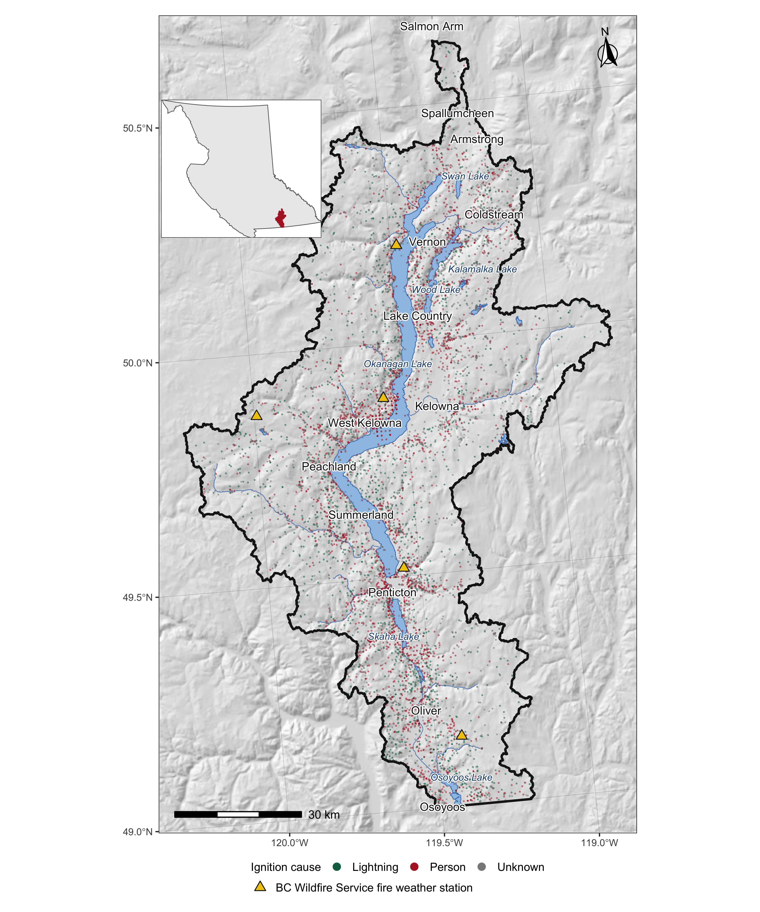
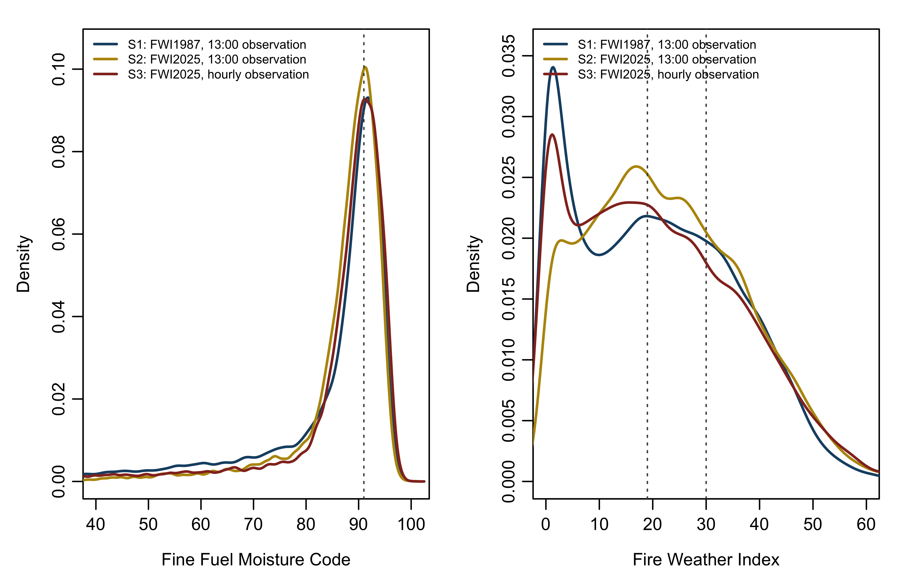
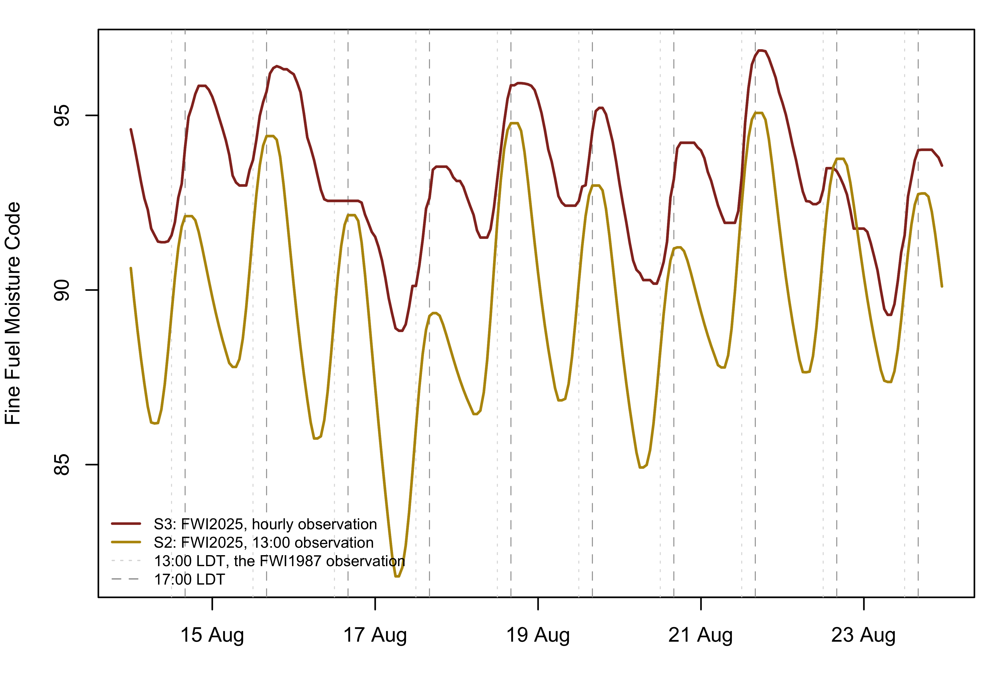
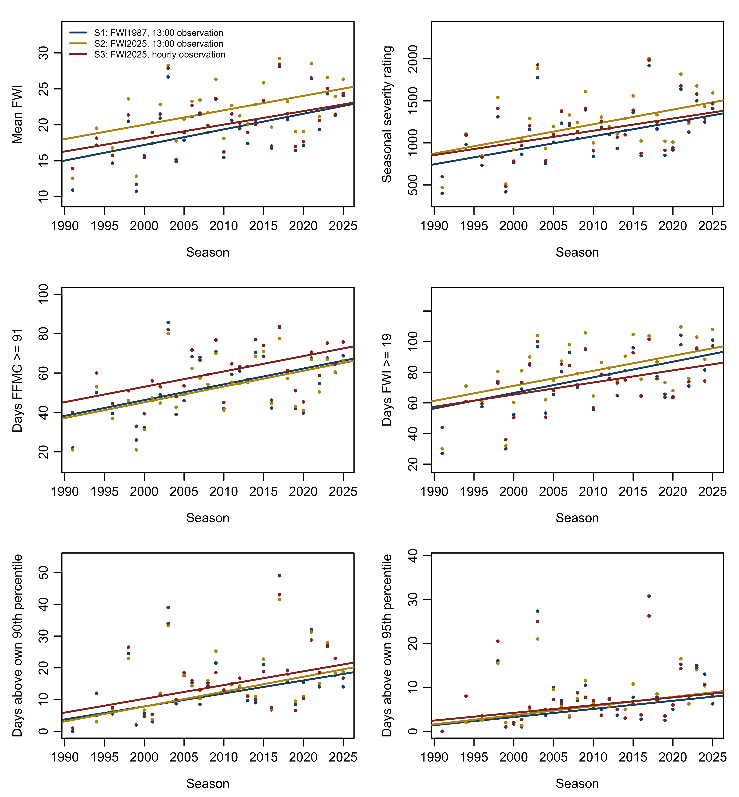
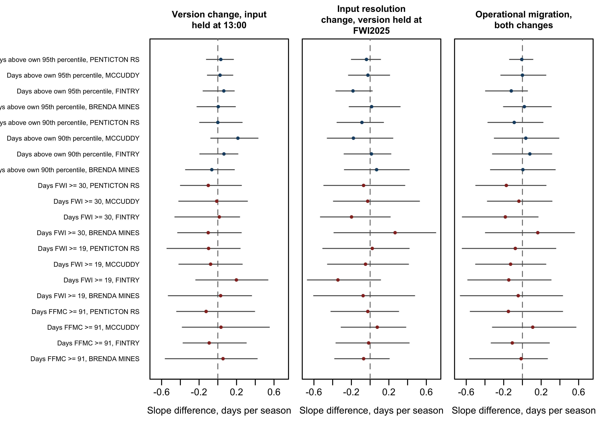
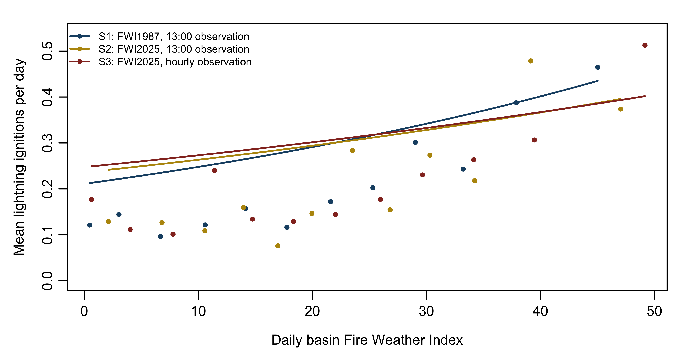

# Version-contingent fire danger trends in the Okanagan basin

*What the 2025 update to the Canadian Forest Fire Weather Index System does to a trend estimate*

Seamus Murphy, ORCID 0000-0002-1792-0351.

Everything below is generated from the render of `01.manuscript/manuscript.qmd` by `05.scripts/build_readme.R`, which quotes the manuscript's own output files and computes nothing of its own.

## Abstract

Almost every published Canadian fire danger trend is expressed in the units of
the 1987 Fire Weather Index System, which Natural Resources Canada replaced in
2025. The successor changes the version of the calculation and the resolution of
the weather driving it at the same time, so a straight comparison of the two
cannot attribute a difference to either. Three danger series were therefore
computed from a single hourly weather record for the Canadian portion of the
Okanagan basin, British Columbia, over 31 fire seasons from 1991 to 2025 at 5
stations, 104 station-seasons in all: FWI1987 from the 13:00 observation, FWI2025
from the same observation through the specification's legacy pathway, and FWI2025
from the observed hourly weather. FWI2025 was computed with the Canadian Forest
Service reference implementation; the FWI1987 implementation reproduces the CRAN
package cffdrs to machine precision and correlates 0.986 with the FWI1987 codes BC
Wildfire Service computed operationally at these stations.

The comparability the 2025 report claims holds for levels and fails for tails. A
Fine Fuel Moisture Code of 91, the value that report names, sits at the 65.1th
percentile of the legacy series and the 62.5th of the hourly FWI2025 series,
which is 57 days per season above it against 62. Trends were estimated with
the Theil-Sen slope and Mann-Kendall tested with the Hamed and Rao correction for
serial correlation, corrected within each metric family for false discovery rate.
Differences between series were bootstrapped by resampling whole seasons, which
preserves the dependence of three series that share one weather record. Of the
12 station-metric combinations under absolute thresholds, 0 gave a migration
slope difference whose corrected interval excluded zero; under thresholds set as
percentiles of each series' own reference distribution, 0 of 8 did. The
resolution of that test is about 13.5 days over the window, so the version change
is established here as a shift in level rather than in slope, which is enough to
break a comparison between a value published under the old system and a value
computed under the new one.

Daily ignition counts were modelled as negative binomial with season as a fixed
effect, so the danger coefficient is identified from within-season variation
alone and cannot be moved by the record keeping: a quarter of the basin's
incidents carry no ignition date at all and both dating and cause attribution
fall sharply after 2000. On held-out seasons the three series differed by 0.0005 in
mean log likelihood per day, with S1: FWI1987, 13:00 observation ranking first.

These results are exploratory: the project's framing, prior-work, design and pre-registration gates were overridden to produce a complete draft, so decisions a pre-registration would have fixed in advance were made with the data in view. The comparison between series is the part the design protects, because all three run on one record through the same decisions.

## Figures

**Figure 1.** Study area, ignition record and weather record. Points are the wildfire incidents recorded inside the basin, coloured by reported cause; triangles are the five BC Wildfire Service fire weather stations, which are the entire weather record used here. Coordinate reference system NAD83 / BC Albers, EPSG:3005.

**Figure 2.** Distribution of the daily Fine Fuel Moisture Code and the daily Fire Weather Index over all kept station-days under the three series, with the absolute thresholds marked.

**Figure 3.** Ten days of the hourly Fine Fuel Moisture Code at Penticton RS in August 2003 under FWI2025 driven by observed hourly weather and by the 13:00 observation alone. Both are the same system on the same days.

**Figure 4.** Seasonal metrics by season under the three series, pooled across stations, with the Theil-Sen line for each.

**Figure 5.** Difference in Theil-Sen slope between series for the five extreme-day counts. Points are station estimates, bars are paired bootstrap 95 per cent intervals.

**Figure 6.** Observed and fitted daily lightning ignition rate against daily basin Fire Weather Index under the three series.

## Tables

**Table 1.** The weather record. Coverage is the share of the 1 April to 30 September hours in which temperature, humidity and wind were all observed, before any gap filling.

| Station | Elevation (m) | First season | Last season | Seasons kept | Seasons dropped | Not reporting | Median coverage |
| :--- | ---: | ---: | ---: | ---: | ---: | ---: | ---: |
| PENTICTON RS | 492 | 1991 | 2025 | 27 | 11 | 0 | 1.000 |
| MCCUDDY | 1023 | 1994 | 2025 | 26 | 11 | 1 | 1.000 |
| FINTRY | 526 | 1996 | 2025 | 25 | 7 | 6 | 1.000 |
| BRENDA MINES | 1463 | 1998 | 2025 | 20 | 17 | 1 | 0.999 |
| WEST KELOWNA | 650 | 2017 | 2024 | 6 | 3 | 28 | 0.998 |

**Table 2.** Completeness of the ignition record by decade. Both dating and cause attribution fall sharply after 2000.

| Decade | Incidents | Dated | Dated % | Attributed | Attributed % |
| :--- | ---: | ---: | ---: | ---: | ---: |
| 1980s | 1338 | 1338 | 100.0 | 1274 | 95.2 |
| 1990s | 1116 | 1116 | 100.0 | 995 | 89.2 |
| 2000s | 3058 | 2100 | 68.7 | 991 | 32.4 |
| 2010s | 1587 | 1259 | 79.3 | 653 | 41.1 |
| 2020s | 1077 | 491 | 45.6 | 630 | 58.5 |

**Table 3.** Verification of the FWI1987 implementation against the CRAN package cffdrs and against the codes BC Wildfire Service computed operationally.

| Check | Component | n | Max absolute difference | Mean absolute difference | Correlation |
| :--- | :--- | :--- | ---: | ---: | ---: |
| against cffdrs | FFMC | 109 | 0.0000000000000995 | 0.00000000000003030 | NA |
| against cffdrs | DMC | 109 | 0.0000000000000746 | 0.00000000000002240 | NA |
| against cffdrs | DC | 109 | 0.0000000000005400 | 0.00000000000017800 | NA |
| against cffdrs | ISI | 109 | 0.0000000000000586 | 0.00000000000001130 | NA |
| against cffdrs | BUI | 109 | 0.0000000000000782 | 0.00000000000002470 | NA |
| against cffdrs | FWI | 109 | 0.0000000000001100 | 0.00000000000001860 | NA |
| against cffdrs | DSR | 109 | 0.0000000000000382 | 0.00000000000000633 | NA |
| against operational codes | BI | 18,149 | NA | 10.69999999999999929 | 0.9834 |
| against operational codes | DC | 18,178 | NA | 165.00000000000000000 | 0.9520 |
| against operational codes | DMC | 18,178 | NA | 1.73999999999999999 | 0.9912 |
| against operational codes | FFMC | 18,178 | NA | 0.11400000000000000 | 0.9960 |
| against operational codes | FWI | 18,149 | NA | 1.22999999999999998 | 0.9928 |
| against operational codes | ISI | 18,149 | NA | 0.06960000000000000 | 0.9984 |

**Table 4.** Where each absolute threshold falls in each series' own 1991 to 2020 reference distribution.

| Series | Component | Threshold | Percentile of threshold | Days per season above | Reference median |
| :--- | :--- | ---: | ---: | ---: | ---: |
| S1: FWI1987, 13:00 observation | FFMC | 91 | 65.1 | 57.2 | 89.3 |
| S2: FWI2025, 13:00 observation | FFMC | 91 | 66.2 | 55.4 | 89.5 |
| S3: FWI2025, hourly observation | FFMC | 91 | 62.5 | 61.9 | 89.8 |
| S1: FWI1987, 13:00 observation | FWI | 19 | 52.5 | 78.1 | 19.3 |
| S2: FWI2025, 13:00 observation | FWI | 19 | 47.6 | 85.4 | 21.4 |
| S3: FWI2025, hourly observation | FWI | 19 | 52.6 | 77.8 | 19.5 |
| S1: FWI1987, 13:00 observation | FWI | 30 | 74.8 | 43.0 | 19.3 |
| S2: FWI2025, 13:00 observation | FWI | 30 | 72.4 | 46.7 | 21.4 |
| S3: FWI2025, hourly observation | FWI | 30 | 75.2 | 42.9 | 19.5 |

**Table 5.** The two quantities FWI2025 reports and FWI1987 cannot: when peak burning conditions occur and how long the burning window stays open.

| Series | Mean peak hour (LST) | Mean burning window (h) | Days per season with window >= 6 h |
| :--- | ---: | ---: | ---: |
| S2: FWI2025, 13:00 observation | 16.02 | 7.26 | 87.2 |
| S3: FWI2025, hourly observation | 16.26 | 11.00 | 96.0 |

**Table 6.** Theil-Sen slopes per season for each seasonal metric under each series, pooled across stations.

| Series | Metric | Stations | Median slope | Slope range | Stations q < 0.05 | Min detectable |
| :--- | :--- | ---: | ---: | :--- | ---: | ---: |
| S1: FWI1987, 13:00 observation | Mean FWI | 4 | 0.176 | 0.07 to 0.37 | 1 | 0.265 |
| S2: FWI2025, 13:00 observation | Mean FWI | 4 | 0.166 | 0.09 to 0.36 | 1 | 0.257 |
| S3: FWI2025, hourly observation | Mean FWI | 4 | 0.181 | 0.04 to 0.38 | 1 | 0.266 |
| S1: FWI1987, 13:00 observation | Seasonal severity rating | 4 | 13.376 | 7.29 to 28.06 | 1 | 22.329 |
| S2: FWI2025, 13:00 observation | Seasonal severity rating | 4 | 13.884 | 5.24 to 29.93 | 1 | 22.988 |
| S3: FWI2025, hourly observation | Seasonal severity rating | 4 | 14.817 | 7.17 to 29.85 | 1 | 23.332 |
| S1: FWI1987, 13:00 observation | Peak BUI | 4 | 1.606 | 0.78 to 2.76 | 0 | 4.291 |
| S2: FWI2025, 13:00 observation | Peak BUI | 4 | 1.671 | 0.91 to 3.05 | 0 | 4.828 |
| S3: FWI2025, hourly observation | Peak BUI | 4 | 1.918 | 1.32 to 3.20 | 0 | 5.150 |
| S1: FWI1987, 13:00 observation | Days FFMC >= 91 | 4 | 0.761 | 0.28 to 1.33 | 1 | 0.981 |
| S2: FWI2025, 13:00 observation | Days FFMC >= 91 | 4 | 0.715 | 0.33 to 1.23 | 2 | 0.883 |
| S3: FWI2025, hourly observation | Days FFMC >= 91 | 4 | 0.741 | 0.26 to 1.22 | 1 | 0.899 |
| S1: FWI1987, 13:00 observation | Days FWI >= 19 | 4 | 0.798 | 0.45 to 1.50 | 1 | 1.316 |
| S2: FWI2025, 13:00 observation | Days FWI >= 19 | 4 | 0.710 | 0.47 to 1.70 | 2 | 1.318 |
| S3: FWI2025, hourly observation | Days FWI >= 19 | 4 | 0.696 | 0.40 to 1.35 | 1 | 1.273 |
| S1: FWI1987, 13:00 observation | Days FWI >= 30 | 4 | 0.711 | 0.20 to 1.43 | 1 | 1.147 |
| S2: FWI2025, 13:00 observation | Days FWI >= 30 | 4 | 0.654 | 0.10 to 1.44 | 2 | 1.103 |
| S3: FWI2025, hourly observation | Days FWI >= 30 | 4 | 0.606 | 0.36 to 1.25 | 1 | 1.089 |
| S1: FWI1987, 13:00 observation | Days above own 90th percentile | 4 | 0.353 | 0.15 to 0.72 | 1 | 0.820 |
| S2: FWI2025, 13:00 observation | Days above own 90th percentile | 4 | 0.461 | 0.09 to 0.79 | 2 | 0.695 |
| S3: FWI2025, hourly observation | Days above own 90th percentile | 4 | 0.327 | 0.15 to 0.80 | 1 | 0.684 |
| S1: FWI1987, 13:00 observation | Days above own 95th percentile | 4 | 0.146 | 0.10 to 0.37 | 1 | 0.550 |
| S2: FWI2025, 13:00 observation | Days above own 95th percentile | 4 | 0.174 | 0.11 to 0.43 | 1 | 0.449 |
| S3: FWI2025, hourly observation | Days above own 95th percentile | 4 | 0.143 | 0.12 to 0.25 | 1 | 0.464 |

**Table 7.** Difference in Theil-Sen slope between series, by metric and contrast, with paired bootstrap intervals.

| Contrast | Scheme | Metric | Stations | Median difference | Stations excluding zero | Stations q < 0.05 |
| :--- | :--- | :--- | ---: | ---: | ---: | ---: |
| Version change, input held at 13:00 | level | Mean FWI | 4 | -0.005 | 0 | 0 |
| Version change, input held at 13:00 | level | Seasonal severity rating | 4 | -0.085 | 0 | 0 |
| Version change, input held at 13:00 | level | Peak BUI | 4 | 0.146 | 0 | 0 |
| Version change, input held at 13:00 | absolute | Days FFMC >= 91 | 4 | -0.029 | 0 | 0 |
| Version change, input held at 13:00 | absolute | Days FWI >= 19 | 4 | -0.023 | 0 | 0 |
| Version change, input held at 13:00 | absolute | Days FWI >= 30 | 4 | -0.057 | 0 | 0 |
| Version change, input held at 13:00 | relative | Days above own 90th percentile | 4 | 0.033 | 0 | 0 |
| Version change, input held at 13:00 | relative | Days above own 95th percentile | 4 | 0.028 | 0 | 0 |
| Input resolution change, version held at FWI2025 | level | Mean FWI | 4 | 0.011 | 0 | 0 |
| Input resolution change, version held at FWI2025 | level | Seasonal severity rating | 4 | 0.923 | 0 | 0 |
| Input resolution change, version held at FWI2025 | level | Peak BUI | 4 | 0.247 | 0 | 0 |
| Input resolution change, version held at FWI2025 | absolute | Days FFMC >= 91 | 4 | -0.021 | 0 | 0 |
| Input resolution change, version held at FWI2025 | absolute | Days FWI >= 19 | 4 | -0.062 | 0 | 0 |
| Input resolution change, version held at FWI2025 | absolute | Days FWI >= 30 | 4 | -0.048 | 0 | 0 |
| Input resolution change, version held at FWI2025 | relative | Days above own 90th percentile | 4 | -0.037 | 0 | 0 |
| Input resolution change, version held at FWI2025 | relative | Days above own 95th percentile | 4 | -0.031 | 0 | 0 |
| Operational migration, both changes | level | Mean FWI | 4 | 0.005 | 0 | 0 |
| Operational migration, both changes | level | Seasonal severity rating | 4 | 1.006 | 0 | 0 |
| Operational migration, both changes | level | Peak BUI | 4 | 0.373 | 0 | 0 |
| Operational migration, both changes | absolute | Days FFMC >= 91 | 4 | -0.061 | 0 | 0 |
| Operational migration, both changes | absolute | Days FWI >= 19 | 4 | -0.101 | 0 | 0 |
| Operational migration, both changes | absolute | Days FWI >= 30 | 4 | -0.105 | 0 | 0 |
| Operational migration, both changes | relative | Days above own 90th percentile | 4 | 0.020 | 0 | 0 |
| Operational migration, both changes | relative | Days above own 95th percentile | 4 | -0.004 | 0 | 0 |

**Table 8.** Sensitivity of the absolute extreme-day counts to how an hourly series is reduced to a daily value.

| Series | Days FFMC >= 91, fixed hour | Days FFMC >= 91, daily maximum | Days FWI >= 19, fixed hour | Days FWI >= 19, daily maximum |
| :--- | ---: | ---: | ---: | ---: |
| S1: FWI1987, 13:00 observation | 57.2 | NA | 78.1 | NA |
| S2: FWI2025, 13:00 observation | 55.4 | 56.3 | 85.4 | 86.5 |
| S3: FWI2025, hourly observation | 61.9 | 72.7 | 77.8 | 92.7 |

**Table 9.** Negative binomial models of daily ignition counts on daily basin Fire Weather Index.

| Response | Series | Coefficient | 95% Wald interval | Rate ratio per 10 FWI | Held-out log likelihood |
| :--- | :--- | ---: | :--- | ---: | ---: |
| Lightning, no size limit | S1: FWI1987, 13:00 observation | 0.0161 | 0.0052 to 0.0269 | 1.17 | -0.4201 |
| Lightning, no size limit | S2: FWI2025, 13:00 observation | 0.0110 | -0.0005 to 0.0225 | 1.12 | -0.4206 |
| Lightning, no size limit | S3: FWI2025, hourly observation | 0.0099 | -0.0003 to 0.0200 | 1.10 | -0.4206 |
| Person, no size limit | S1: FWI1987, 13:00 observation | 0.0480 | 0.0421 to 0.0539 | 1.62 | NA |
| Person, no size limit | S2: FWI2025, 13:00 observation | 0.0489 | 0.0428 to 0.0550 | 1.63 | NA |
| Person, no size limit | S3: FWI2025, hourly observation | 0.0412 | 0.0360 to 0.0465 | 1.51 | NA |
| All causes, no size limit | S1: FWI1987, 13:00 observation | 0.0332 | 0.0289 to 0.0375 | 1.39 | -1.1637 |
| All causes, no size limit | S2: FWI2025, 13:00 observation | 0.0329 | 0.0283 to 0.0374 | 1.39 | -1.1664 |
| All causes, no size limit | S3: FWI2025, hourly observation | 0.0287 | 0.0247 to 0.0327 | 1.33 | -1.1672 |
| All causes, at least 1 ha | S1: FWI1987, 13:00 observation | 0.0706 | 0.0585 to 0.0827 | 2.03 | NA |
| All causes, at least 1 ha | S2: FWI2025, 13:00 observation | 0.0702 | 0.0582 to 0.0823 | 2.02 | NA |
| All causes, at least 1 ha | S3: FWI2025, hourly observation | 0.0670 | 0.0568 to 0.0772 | 1.95 | NA |
| All causes, at least 4 ha | S1: FWI1987, 13:00 observation | 0.0846 | 0.0673 to 0.1018 | 2.33 | NA |
| All causes, at least 4 ha | S2: FWI2025, 13:00 observation | 0.0826 | 0.0660 to 0.0992 | 2.28 | NA |
| All causes, at least 4 ha | S3: FWI2025, hourly observation | 0.0845 | 0.0706 to 0.0984 | 2.33 | NA |

**Table 10.** Test of whether the within-season danger to ignition relationship changes across the record.

| Response | Series | Interaction | Standard error | p |
| :--- | :--- | ---: | ---: | ---: |
| Lightning, no size limit | S1: FWI1987, 13:00 observation | -0.0000337 | 0.000512 | 0.947 |
| Lightning, no size limit | S2: FWI2025, 13:00 observation | 0.0001930 | 0.000537 | 0.720 |
| Lightning, no size limit | S3: FWI2025, hourly observation | -0.0000706 | 0.000466 | 0.880 |
| All causes, no size limit | S1: FWI1987, 13:00 observation | -0.0000276 | 0.000217 | 0.899 |
| All causes, no size limit | S2: FWI2025, 13:00 observation | 0.0000828 | 0.000227 | 0.715 |
| All causes, no size limit | S3: FWI2025, hourly observation | 0.0000213 | 0.000196 | 0.913 |

**Table 11.** How each change moves the seasonal count of extreme days, in days per season.

| Metric | Version change | Input resolution change | Migration, both |
| :--- | ---: | ---: | ---: |
| Days FFMC >= 91 | -1.8 | 6.5 | 4.7 |
| Days FWI >= 19 | 7.3 | -7.6 | -0.3 |

**Table 12.** What a window of this length can and cannot resolve.

| Metric | Median observed slope | Minimum detectable slope | Minimum detectable change over the window | Observed change over the window |
| :--- | ---: | ---: | ---: | ---: |
| Mean FWI | 0.180 | 0.262 | 8.90 | 6.14 |
| Seasonal severity rating | 13.486 | 23.199 | 788.75 | 458.54 |
| Peak BUI | 1.740 | 5.016 | 170.55 | 59.17 |
| Days FFMC >= 91 | 0.741 | 0.928 | 31.55 | 25.19 |
| Days FWI >= 19 | 0.739 | 1.301 | 44.24 | 25.11 |
| Days FWI >= 30 | 0.625 | 1.089 | 37.03 | 21.25 |
| Days above own 90th percentile | 0.377 | 0.710 | 24.15 | 12.82 |
| Days above own 95th percentile | 0.146 | 0.483 | 16.42 | 4.98 |

